# 七类白模的真实数据集样例：以 SolarRenderer 为主

提取日期：2026-11-06。7 个主例 + 3 个类内变体，全部从公开的 **SolarRenderer-Data 原始 condition.mp4** 下载并抽帧；没有生成或重绘白模示意图。

[打开可播放样例页](https://njuvictoria.github.io/white-model-video-gallery/) · [样例清单与原始元数据](manifest.json) · [数据集](https://huggingface.co/datasets/Enderfga/SolarRenderer-Data)

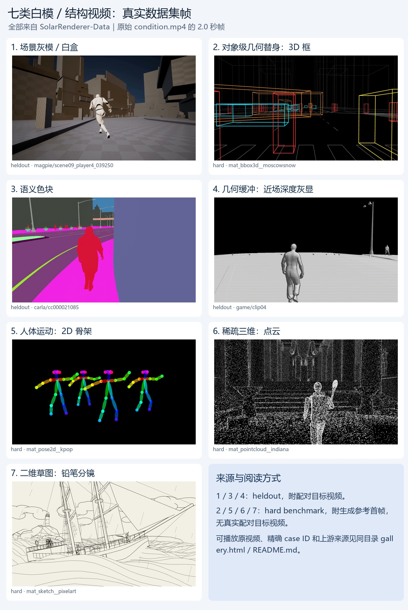

## 数据来源与是否配对

- **直接下载来源**：Enderfga/SolarRenderer-Data。上游来源另列，不能把 SolarRenderer 所有视频都说成 Magpie。
- **heldout**：这里选的灰模、语义图、近场几何和补充 mask 样例有真实配对的 `render.mp4`；“真实配对”指数据集指定目标，不意味着是现实拍摄，内容可以是游戏/仿真。
- **hard**：这里选的框、骨架、点云、草图等 `ground_truth=null`；其 first_frame 是作者用图像模型生成的外观参考，不能当作真实目标视频。
- 七类为本调研归纳；数据集 condition 原标签保留。每个目录的 `source-metadata.json` 保留来源字段及原始索引链接；prompt 链接指向原数据集文件或含该条 caption 的索引。

## SolarRenderer 要重点区分的三层数据

| 发布部分 | 范围 | 与这七类的关系 |
| --- | --- | --- |
| 公开训练集 | Magpie 灰盒 30,597；CARLA 语义图 25,317；UnrealZoo mask＋骨架 1,824，共 57,738 对 | 不是七类都具备大规模公开训练配对 |
| heldout | 53 对，有结构、真实配对目标、首帧、prompt | 本次灰盒、语义图、近场深度和补充 mask 从这里选 |
| hard benchmark | 208 个 case、16 种结构表示；相同结构可换多个外观版本 | 本次框、骨架、点云、草图和补充 SMPL/体素从这里选；没有对应目标视频真值 |

因此，七类可以都找到可视样例，但不能据此推断七类都有现成的白模—目标训练对。框、点云、草图等在这里主要用于测试结构泛化。

| 类别 | 样例 ID | split | 上游来源 | 有目标视频 |
| --- | --- | --- | --- | --- |
| 1. 场景灰模／白盒 | `magpie/scene09_player4_039250` | heldout | Magpie / MogoAI/Magpie_lite；SolarRenderer 切片 | 有，数据集配对 render |
| 2. 对象级几何替身：3D 框 | `mat_bbox3d__moscowsnow` | hard | SolarRenderer 作者构建的引擎结构片段 | 无，只有生成首帧参考 |
| 3. 语义色块 | `carla/cc000021085` | heldout | CARLA 0.9.16 引擎导出；SolarRenderer 录制 | 有，数据集配对 render |
| 4. 几何缓冲：近场深度灰显 | `game/clip04` | heldout | SolarRenderer 的 game 引擎录制；源游戏/完整采集集未具名公开 | 有，数据集配对 render |
| 5. 人体运动：2D 骨架 | `mat_pose2d__kpop` | hard | SolarRenderer 作者构建的引擎结构片段 | 无，只有生成首帧参考 |
| 6. 稀疏三维：点云 | `mat_pointcloud__indiana` | hard | SolarRenderer 作者构建的引擎结构片段 | 无，只有生成首帧参考 |
| 7. 二维草图：铅笔分镜 | `mat_sketch__pixelart` | hard | SolarRenderer 作者构建的引擎结构片段 | 无，只有生成首帧参考 |

## 场景灰模／白盒

- 样例：`magpie/scene09_player4_039250`；split：`benchmark/heldout`。
- 作者标签：`scene grey box (engine white-box)`。
- 上游来源：Magpie / MogoAI/Magpie_lite；SolarRenderer 切片。
- 目标视频：有原始配对 render.mp4。

灰白人体与城市体块，表面有检查格和基础明暗；保留场景几何、人物和镜头运动。

这是去外观的完整场景，不是只用一个盒子代表人物。灰模也可能带天空色、检查格及简单光照。

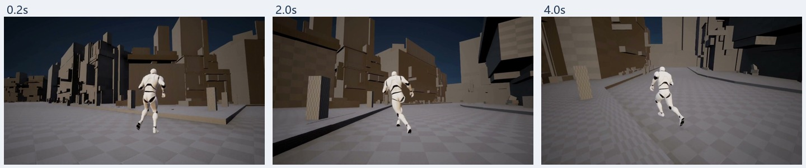

[原始条件视频](https://huggingface.co/datasets/Enderfga/SolarRenderer-Data/resolve/main/benchmark/heldout/clips/magpie/scene09_player4_039250/condition.mp4) · [作者原视频](https://huggingface.co/datasets/Enderfga/SolarRenderer-Data/resolve/main/benchmark/heldout/clips/magpie/scene09_player4_039250/condition.mp4) · [元数据](01-graybox-run/source-metadata.json) · [prompt](https://huggingface.co/datasets/Enderfga/SolarRenderer-Data/resolve/main/benchmark/heldout/cases.jsonl)
[原始配对目标视频](https://huggingface.co/datasets/Enderfga/SolarRenderer-Data/resolve/main/benchmark/heldout/clips/magpie/scene09_player4_039250/render.mp4) · [作者目标视频](https://huggingface.co/datasets/Enderfga/SolarRenderer-Data/resolve/main/benchmark/heldout/clips/magpie/scene09_player4_039250/render.mp4)
[上游来源](https://huggingface.co/datasets/MogoAI/Magpie_lite)

## 对象级几何替身：3D 框

- 样例：`mat_bbox3d__moscowsnow`；split：`benchmark/hard`。
- 作者标签：`3D bounding boxes (driving format)`。
- 上游来源：SolarRenderer 作者构建的引擎结构片段。
- 目标视频：无配对真值，参考首帧是生成图。

黑底城市道路中，车辆和人物用彩色三维线框盒表示，仍能看到体积、位置与运动。

本例是 3D 框的线框画法，归对象几何替身；不能因为有线条就归绘画草图。颜色是代理编码，不代表目标衣服颜色。

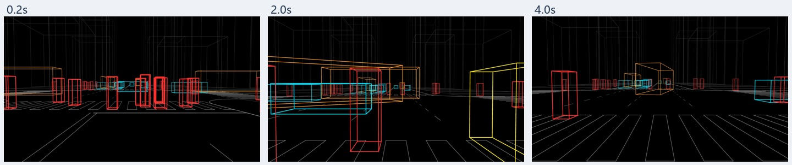

[原始条件视频](https://huggingface.co/datasets/Enderfga/SolarRenderer-Data/resolve/main/benchmark/hard/mat_bbox3d__moscowsnow/condition.mp4) · [作者原视频](https://huggingface.co/datasets/Enderfga/SolarRenderer-Data/resolve/main/benchmark/hard/mat_bbox3d__moscowsnow/condition.mp4) · [元数据](02-boxes/source-metadata.json) · [prompt](https://huggingface.co/datasets/Enderfga/SolarRenderer-Data/resolve/main/benchmark/hard/mat_bbox3d__moscowsnow/prompt.txt)

## 语义色块

- 样例：`carla/cc000021085`；split：`benchmark/heldout`。
- 作者标签：`semantic segmentation (engine export)`。
- 上游来源：CARLA 0.9.16 引擎导出；SolarRenderer 录制。
- 目标视频：有原始配对 render.mp4。

行人、道路、人行道、墙面等区域使用平涂色块；人物还有轮廓，但衣物纹理消失。

这里颜色表示类别。两个同类行人可同色，不等于实例 ID；与彩色几何框不同。

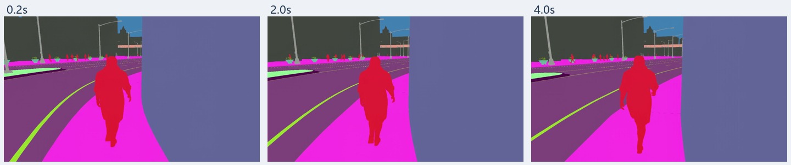

[原始条件视频](https://huggingface.co/datasets/Enderfga/SolarRenderer-Data/resolve/main/benchmark/heldout/clips/carla/cc000021085/condition.mp4) · [作者原视频](https://huggingface.co/datasets/Enderfga/SolarRenderer-Data/resolve/main/benchmark/heldout/clips/carla/cc000021085/condition.mp4) · [元数据](03-semantic/source-metadata.json) · [prompt](https://huggingface.co/datasets/Enderfga/SolarRenderer-Data/resolve/main/benchmark/heldout/cases.jsonl)
[原始配对目标视频](https://huggingface.co/datasets/Enderfga/SolarRenderer-Data/resolve/main/benchmark/heldout/clips/carla/cc000021085/render.mp4) · [作者目标视频](https://huggingface.co/datasets/Enderfga/SolarRenderer-Data/resolve/main/benchmark/heldout/clips/carla/cc000021085/render.mp4)
[上游来源](https://carla.org/)

## 几何缓冲：近场深度灰显

- 样例：`game/clip04`；split：`benchmark/heldout`。
- 作者标签：`near-field shaded geometry (depth within 30 m)`。
- 上游来源：SolarRenderer 的 game 引擎录制；源游戏/完整采集集未具名公开。
- 目标视频：有原始配对 render.mp4。

近处人物、地面和路灯以灰色几何明暗呈现，远景和天空为黑色。

元数据标为约 30 米内的 near-field shaded geometry，是深度派生的几何灰显，不是目标场景的真实灰色材质。

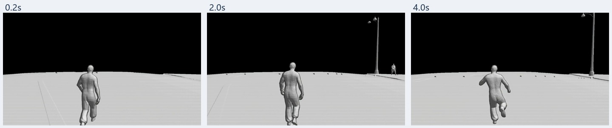

[原始条件视频](https://huggingface.co/datasets/Enderfga/SolarRenderer-Data/resolve/main/benchmark/heldout/clips/game/clip04/condition.mp4) · [作者原视频](https://huggingface.co/datasets/Enderfga/SolarRenderer-Data/resolve/main/benchmark/heldout/clips/game/clip04/condition.mp4) · [元数据](04-depth/source-metadata.json) · [prompt](https://huggingface.co/datasets/Enderfga/SolarRenderer-Data/resolve/main/benchmark/heldout/cases.jsonl)
[原始配对目标视频](https://huggingface.co/datasets/Enderfga/SolarRenderer-Data/resolve/main/benchmark/heldout/clips/game/clip04/render.mp4) · [作者目标视频](https://huggingface.co/datasets/Enderfga/SolarRenderer-Data/resolve/main/benchmark/heldout/clips/game/clip04/render.mp4)

## 人体运动：2D 骨架

- 样例：`mat_pose2d__kpop`；split：`benchmark/hard`。
- 作者标签：`2D pose skeleton`。
- 上游来源：SolarRenderer 作者构建的引擎结构片段。
- 目标视频：无配对真值，参考首帧是生成图。

黑色背景上，多个人体由彩色关节点与连线构成，可观察动作变化。

提供骨架运动，几乎没有衣服、实体表面和环境。它与下面 SMPL 灰色人体都归人体运动大类。

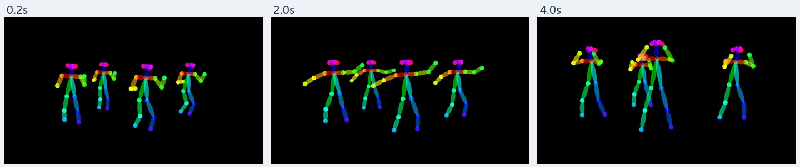

[原始条件视频](https://huggingface.co/datasets/Enderfga/SolarRenderer-Data/resolve/main/benchmark/hard/mat_pose2d__kpop/condition.mp4) · [作者原视频](https://huggingface.co/datasets/Enderfga/SolarRenderer-Data/resolve/main/benchmark/hard/mat_pose2d__kpop/condition.mp4) · [元数据](05-skeleton/source-metadata.json) · [prompt](https://huggingface.co/datasets/Enderfga/SolarRenderer-Data/resolve/main/benchmark/hard/mat_pose2d__kpop/prompt.txt)

## 稀疏三维：点云

- 样例：`mat_pointcloud__indiana`；split：`benchmark/hard`。
- 作者标签：`point cloud`。
- 上游来源：SolarRenderer 作者构建的引擎结构片段。
- 目标视频：无配对真值，参考首帧是生成图。

场景和前景人物由离散的浅色点组成，实体表面并不连续。

这是数据集发布的点云渲染视频，不是原始 PLY/PCD 点云文件；本例被标为训练未见的结构类型。

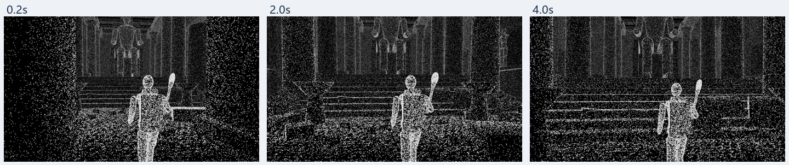

[原始条件视频](https://huggingface.co/datasets/Enderfga/SolarRenderer-Data/resolve/main/benchmark/hard/mat_pointcloud__indiana/condition.mp4) · [作者原视频](https://huggingface.co/datasets/Enderfga/SolarRenderer-Data/resolve/main/benchmark/hard/mat_pointcloud__indiana/condition.mp4) · [元数据](06-pointcloud/source-metadata.json) · [prompt](https://huggingface.co/datasets/Enderfga/SolarRenderer-Data/resolve/main/benchmark/hard/mat_pointcloud__indiana/prompt.txt)

## 二维草图：铅笔分镜

- 样例：`mat_sketch__pixelart`；split：`benchmark/hard`。
- 作者标签：`pencil storyboard`。
- 上游来源：SolarRenderer 作者构建的引擎结构片段。
- 目标视频：无配对真值，参考首帧是生成图。

浅色纸面上以铅笔线描绘船只、桅杆与海面，保留大致构图和随时间的变化。

指结构输入本身是分镜草图；case 名中的 pixelart 是目标外观标签，不是草图条件类型。

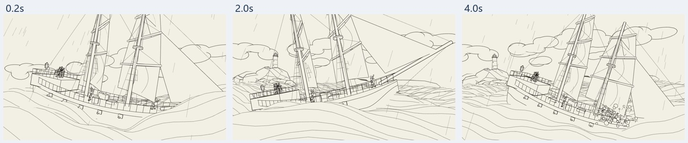

[原始条件视频](https://huggingface.co/datasets/Enderfga/SolarRenderer-Data/resolve/main/benchmark/hard/mat_sketch__pixelart/condition.mp4) · [作者原视频](https://huggingface.co/datasets/Enderfga/SolarRenderer-Data/resolve/main/benchmark/hard/mat_sketch__pixelart/condition.mp4) · [元数据](07-sketch/source-metadata.json) · [prompt](https://huggingface.co/datasets/Enderfga/SolarRenderer-Data/resolve/main/benchmark/hard/mat_sketch__pixelart/prompt.txt)

## 补充：SMPL 人体网格

- 样例：`smpl-trailer-combo__knight`；split：`benchmark/hard`。
- 作者标签：`SMPL body mesh`。
- 上游来源：拟合 SMPL 运动，白底渲染；具体原视频由该条元数据未注明。
- 目标视频：无配对真值，参考首帧是生成图。

白色背景上的灰色人体网格，能看到四肢体积和姿势变化。

同属第 5 类，相比 2D 骨架多了人体体积，仍缺服装和完整环境；原始拟合视频未在此条元数据中具名。

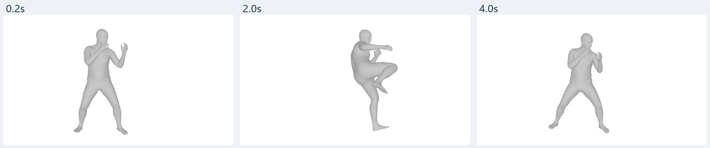

[原始条件视频](https://huggingface.co/datasets/Enderfga/SolarRenderer-Data/resolve/main/benchmark/hard/smpl-trailer-combo__knight/condition.mp4) · [作者原视频](https://huggingface.co/datasets/Enderfga/SolarRenderer-Data/resolve/main/benchmark/hard/smpl-trailer-combo__knight/condition.mp4) · [元数据](05b-smpl/source-metadata.json) · [prompt](https://huggingface.co/datasets/Enderfga/SolarRenderer-Data/resolve/main/benchmark/hard/smpl-trailer-combo__knight/prompt.txt)

## 补充：体素

- 样例：`mat_voxel__westeros`；split：`benchmark/hard`。
- 作者标签：`voxels`。
- 上游来源：SolarRenderer 作者构建的引擎结构片段。
- 目标视频：无配对真值，参考首帧是生成图。

城堡、树木、地面和人物以规则方块构成，包含粗颜色。

同属第 6 类；体素可以带色。分类依据空间离散结构，不依据是否纯白。

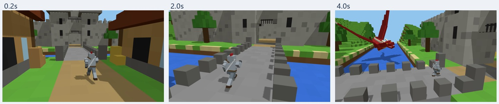

[原始条件视频](https://huggingface.co/datasets/Enderfga/SolarRenderer-Data/resolve/main/benchmark/hard/mat_voxel__westeros/condition.mp4) · [作者原视频](https://huggingface.co/datasets/Enderfga/SolarRenderer-Data/resolve/main/benchmark/hard/mat_voxel__westeros/condition.mp4) · [元数据](06b-voxel/source-metadata.json) · [prompt](https://huggingface.co/datasets/Enderfga/SolarRenderer-Data/resolve/main/benchmark/hard/mat_voxel__westeros/prompt.txt)

## 补充：实例 mask＋骨架

- 样例：`unrealzoo/uz_Arctic_s14700002_05_fps`；split：`benchmark/heldout`。
- 作者标签：`object masks + character skeletons (engine export)`。
- 上游来源：UnrealZoo 环境引擎导出；SolarRenderer 录制。
- 目标视频：有原始配对 render.mp4。

场景对象用大块平涂颜色表示；本帧主要看到岩石和地面等场景区域。

作者标注为 object masks + character skeletons，但抽取帧没有明显人物骨架；不能为贴合名称而声称画面里一定有人。

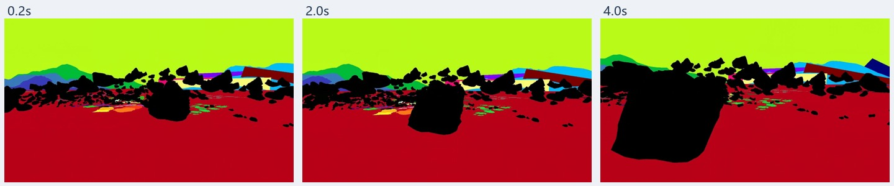

[原始条件视频](https://huggingface.co/datasets/Enderfga/SolarRenderer-Data/resolve/main/benchmark/heldout/clips/unrealzoo/uz_Arctic_s14700002_05_fps/condition.mp4) · [作者原视频](https://huggingface.co/datasets/Enderfga/SolarRenderer-Data/resolve/main/benchmark/heldout/clips/unrealzoo/uz_Arctic_s14700002_05_fps/condition.mp4) · [元数据](03b-masks/source-metadata.json) · [prompt](https://huggingface.co/datasets/Enderfga/SolarRenderer-Data/resolve/main/benchmark/heldout/cases.jsonl)
[原始配对目标视频](https://huggingface.co/datasets/Enderfga/SolarRenderer-Data/resolve/main/benchmark/heldout/clips/unrealzoo/uz_Arctic_s14700002_05_fps/render.mp4) · [作者目标视频](https://huggingface.co/datasets/Enderfga/SolarRenderer-Data/resolve/main/benchmark/heldout/clips/unrealzoo/uz_Arctic_s14700002_05_fps/render.mp4)
[上游来源](https://github.com/UnrealZoo/unrealzoo-gym)

[来源与素材许可说明](ATTRIBUTION.md)
